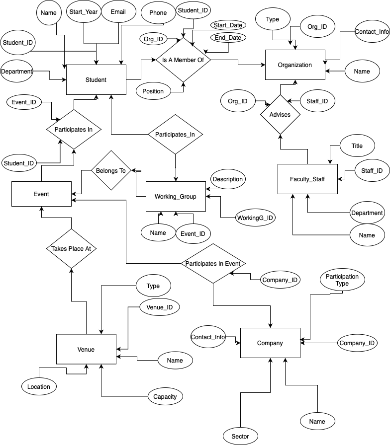
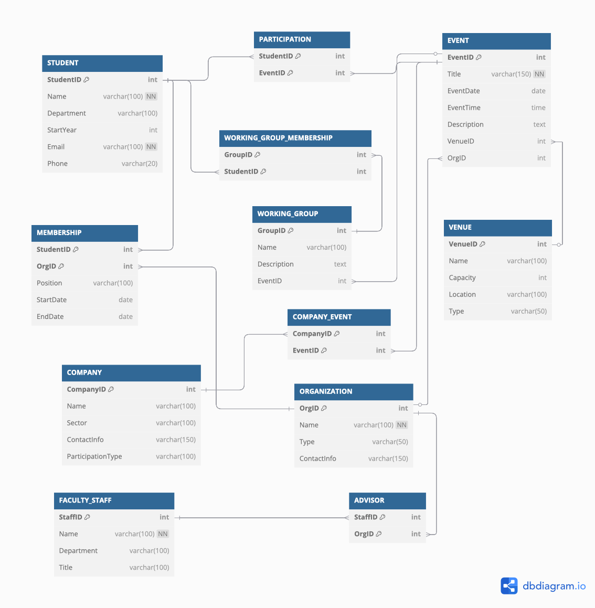

# Student Clubs & Organizations Database Management System

A relational database for managing student clubs at Boğaziçi University: their members, advisors, events, venues, working groups and company partnerships.

Built as the term project for **MIS 236 Database Systems** (Boğaziçi University, Spring 2025) by a team of three. The work covered the full cycle: case scenario, conceptual design, relational design, implementation and querying.

## The problem

Club activity on campus is tracked in scattered spreadsheets and message threads. That makes it hard to answer simple questions: who is a member of which club, which venue is free, which companies sponsored which events. This project designs a single database that the four user groups (students, club representatives, administrative staff and faculty advisors) could all work from.

## Design

**Entity–relationship diagram**

**Relational model**

The schema has 12 tables: 6 entity tables and 6 tables that resolve many-to-many relationships.

| Table | Holds |
| --- | --- |
| `Student` | Students, with department, start year and contact details |
| `Faculty_Staff` | Faculty and staff members |
| `Organization` | Student clubs and societies |
| `Venue` | Campus locations, with capacity and type |
| `Event` | Events, each tied to an organizing club and a venue |
| `Company` | Companies that take part in events |
| `Working_Group` | Teams formed for a specific event |
| `Membership` | Student ↔ organization, with position and dates |
| `Advisor` | Faculty/staff ↔ organization |
| `Participation` | Student ↔ event |
| `Company_Event` | Company ↔ event |
| `Working_Group_Membership` | Student ↔ working group |

Every relation was checked against its functional dependencies and is in third normal form (3NF).

**Business rules enforced with `CHECK` constraints**

- Student e-mail addresses must end in `.edu.tr`.
- Venue capacity must be greater than 0.
- A membership's end date must be after its start date.
- A company's participation type must be one of four allowed values.

## Repository contents

| File | Purpose |
| --- | --- |
| [`sql/01_schema.sql`](sql/01_schema.sql) | `CREATE TABLE` statements with primary and foreign keys |
| [`sql/02_sample_data.sql`](sql/02_sample_data.sql) | 20 sample rows per table |
| [`sql/03_constraints.sql`](sql/03_constraints.sql) | `CHECK` constraints |
| [`sql/04_queries.sql`](sql/04_queries.sql) | 10 reporting queries |
| [`sql/05_stored_procedures.sql`](sql/05_stored_procedures.sql) | 3 stored procedures |

## Queries

The ten queries answer questions the system's users would actually ask, and were chosen to exercise different techniques:

| # | Question | Technique |
| --- | --- | --- |
| 1 | Which events are organized by cultural clubs? | `JOIN` + filter |
| 2 | Which companies attended events that Computer Engineering students went to? | `IN` subquery |
| 3 | Which events had both student and company participation? | Two `EXISTS` |
| 4 | Which clubs have both an advisor and at least one member? | Two `EXISTS` |
| 5 | Which faculty members advise clubs whose events drew companies? | Five-table `JOIN` |
| 6 | Which companies attended every event of a given club? | Relational division with `NOT EXISTS` |
| 7 | How involved is each student (events, clubs, working groups)? | `LEFT JOIN` + `COUNT(DISTINCT)` |
| 8 | What does each club look like (members, events, advisor)? | `LEFT JOIN` + `GROUP BY` |
| 9 | How active is each company (events, venues)? | `JOIN` + `GROUP BY` |
| 10 | Who is in each working group? | `JOIN` + `ORDER BY` |

The stored procedures take a parameter and return events by company, students by department, and events by minimum venue capacity.

## Running it

The project was developed on **Microsoft SQL Server**. Run the files in `sql/` in numbered order.

Files 01–04 use standard SQL and also run on PostgreSQL. File 05 uses T-SQL syntax (`CREATE OR ALTER PROCEDURE`, `GO`, `EXEC`) and needs SQL Server.

## Notes

- All student and staff records in the sample data are fictional.
- Sample values (departments, club types, event titles) are in Turkish, as in the original project.
